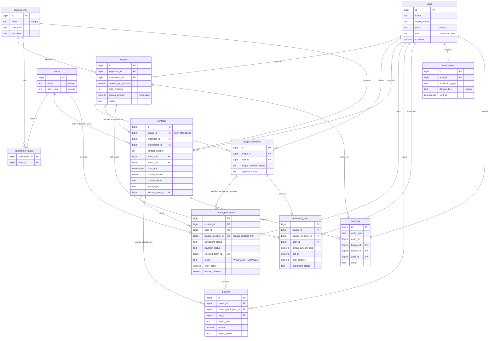

# Dugout XI: Database design (PostgreSQL)

Twelve tables. Money is status only: the app records who paid and who is owed, and calculates profit and loss, but never moves money. Profit/loss, balances, stats and rankings are always calculated from the result columns on `contest_participants`, so a result correction can never leave a stored total wrong.

## 1. Conventions

- PostgreSQL 15 or later, schema managed with Flyway migrations, names in snake_case.
- Ids are `bigint generated always as identity`. League invitation links use a random `invite_code`.
- Money is `numeric` in INR (`BigDecimal` in Java). Timestamps are `timestamptz`, stored in UTC (`Instant` in Java, `hibernate.jdbc.time_zone=UTC`).
- Status fields are `text` with a `CHECK` list and a Java enum, not native Postgres enum types, so a new status is a simple migration.
- Status column names: `leagues.status`, `league_members.league_member_status`, `contests.contest_status`, `contest_participants.participant_status`, `payouts.payout_status`, `settlement_rows.settlement_status`. The paid/unpaid flag is `payment_status` on both `league_members` and `contest_participants`.
- Mutable tables carry `version integer` (JPA `@Version`) plus `created_at` and `updated_at`. `notifications` and `audit_log` have no version because their rows never change except for send and read stamps.
- Nothing is deleted when money or history is involved. Rows change status (VOID, REMOVED, CANCELLED, `is_active = false`). All foreign keys use the default restrict rule, with no cascading deletes.
- Jobs lock the rows they pick with `FOR UPDATE SKIP LOCKED`, so a second run or a second instance skips them.
- All `@ManyToOne` use `fetch = LAZY`.

## 2. Tables at a glance

| # | Table | Holds |
|---|---|---|
| 1 | users | Accounts and profile. Role is USER or ADMIN |
| 2 | teams | Teams, stored once (India is one row) |
| 3 | tournaments | IPL 2026, Asia Cup 2026, World Cup 2027 |
| 4 | tournament_teams | Which teams play in which tournament |
| 5 | leagues | League settings, joining amount, status |
| 6 | league_members | Membership and payment of the joining amount |
| 7 | contests | League and standalone contests, two teams, start time, result |
| 8 | contest_participants | One row per user per contest: membership, prediction and result |
| 9 | payouts | Standalone contest winnings and refunds the organizer owes |
| 10 | settlement_rows | League end: one row per member for the money returned |
| 11 | notifications | In-app notifications and scheduled reminders |
| 12 | audit_log | Append-only history of every important change |
| optional | shedlock | Job lock table, only if you run 2 or more app instances. Skipped in V1 |

## 3. Relationships

### Diagram

Mermaid renders this in GitHub, GitLab, VS Code (with a Mermaid preview extension) and most Markdown viewers. An Excalidraw version is in `database-design.excalidraw`.



Not drawn: `shedlock`, and the composite keys explained below.

### Foreign keys

| From | Column | To |
|---|---|---|
| leagues | organizer_id | users |
| leagues | force_closed_by | users |
| leagues | tournament_id | tournaments |
| tournament_teams | tournament_id | tournaments |
| tournament_teams | team_id | teams |
| league_members | league_id | leagues |
| league_members | user_id | users |
| contests | league_id | leagues (null for standalone) |
| contests | organizer_id, result_entered_by | users |
| contests | tournament_id | tournaments |
| contests | winning_team_id | teams |
| contests | (tournament_id, team_a_id), (tournament_id, team_b_id) | tournament_teams |
| contests | (league_id, tournament_id) | leagues (id, tournament_id) |
| contest_participants | contest_id | contests |
| contest_participants | user_id | users |
| contest_participants | league_member_id | league_members (null for standalone) |
| contest_participants | selected_team_id | teams |
| payouts | contest_id, contest_participant_id, user_id, paid_out_by | contests, contest_participants, users, users |
| settlement_rows | league_id, league_member_id, user_id, settled_by | leagues, league_members, users, users |
| notifications | user_id | users |
| audit_log | league_id, contest_id, actor_id | leagues, contests, users |

Three composite keys do real work:

- `contests (tournament_id, team_a_id)` and `(tournament_id, team_b_id)` point at `tournament_teams`. Postgres refuses a contest whose teams don't play in its tournament.
- `contests (league_id, tournament_id)` points at `leagues (id, tournament_id)`. A league contest must use its league's tournament. For a standalone contest `league_id` is null, so this check is skipped.

### Delete rules

No cascading deletes anywhere. Deleting a user, team, tournament, league or contest that is referenced is refused by the database. Use `is_active = false` for users, teams and tournaments, and the status columns for everything else.

## 4. Tables

### 4.1 users

One table for login and profile. `role` and `is_active` can only be changed through an admin endpoint. The update-profile endpoint accepts a DTO with only `name`, `display_name`, `phone_number`, `photo_url` and `upi_id`.

```sql
create table users (
  id            bigint generated always as identity primary key,
  name          text        not null,
  display_name  text        not null,         -- shown on boards and lists; defaults to name
  email         text        not null,
  password_hash text        not null,         -- BCrypt hash, never the password
  phone_number  text,
  photo_url     text,
  upi_id        text,                         -- where the organizer sends a member's money
  role          text        not null default 'USER' check (role in ('USER','ADMIN')),
  is_active     boolean     not null default true,
  created_at    timestamptz not null default now(),
  updated_at    timestamptz not null default now(),
  version       integer     not null default 0
);
create unique index uq_users_email on users (lower(email));
```

- `display_name` is not unique, since two friends can both be "Rahul".
- Emails are stored lower-cased by the service.
- Phone and UPI are visible only to members of the same league (API rule).
- No wallet or `total_amount` in V1.

Added by V15 (passwords without email):

```sql
alter table users
  add column must_change_password        boolean not null default false, -- set by an admin reset
  add column password_changed_at         timestamptz,  -- tokens issued before this are refused
  add column password_reset_requested_at timestamptz;  -- "forgot password" cool-down, one alert an hour
```

### 4.2 teams

```sql
create table teams (
  id         bigint generated always as identity primary key,
  name       text        not null unique,     -- 'India', 'Mumbai Indians'
  short_code text        not null unique,     -- 'IND', 'MI'
  logo_url   text,
  is_active  boolean     not null default true,
  created_at timestamptz not null default now(),
  updated_at timestamptz not null default now(),
  version    integer     not null default 0
);
```

A team exists once and plays in many tournaments. It has no won/lost counters, because those can be calculated from contests. If a short code ever clashes between a national team and a franchise, make it unique per team type.

### 4.3 tournaments and tournament_teams

```sql
create table tournaments (
  id         bigint generated always as identity primary key,
  name       text        not null unique,     -- 'IPL 2026', 'Asia Cup 2026'
  start_date date,
  end_date   date,
  is_active  boolean     not null default true,
  created_at timestamptz not null default now(),
  updated_at timestamptz not null default now(),
  version    integer     not null default 0
);

create table tournament_teams (
  tournament_id bigint not null references tournaments(id),
  team_id       bigint not null references teams(id),
  primary key (tournament_id, team_id)
);
create index ix_tt_team on tournament_teams (team_id);
```

`tournament_teams` is a pure link table. In Java it is a `@ManyToMany` on `Tournament`, with no entity of its own. Tournaments and their teams are loaded by a Flyway seed, with admin-only endpoints to add or edit them: `GET /tournaments`, `GET /tournaments/{id}/teams`, `POST /tournaments`, `POST /teams`, and add or remove a team from a tournament.

### 4.4 leagues

```sql
create table leagues (
  id                    bigint generated always as identity primary key,
  organizer_id          bigint        not null references users(id),
  tournament_id         bigint        not null references tournaments(id),
  name                  text          not null,
  amount_per_contest    numeric(10,2) not null check (amount_per_contest > 0),
  total_contests        integer       not null check (total_contests > 0),
  joining_amount        numeric(12,2) generated always as (amount_per_contest * total_contests) stored,
  registration_start    timestamptz   not null,
  registration_deadline timestamptz   not null,
  payment_deadline      timestamptz   not null,
  payment_instructions  text,
  invite_code           text          not null unique,
  status                text          not null default 'UPCOMING'
    check (status in ('UPCOMING','OPEN','ACTIVE','PENDING_SETTLEMENT','COMPLETED','CANCELLED')),
  started_at            timestamptz,
  ended_at              timestamptz,
  completed_at          timestamptz,
  force_closed_by       bigint references users(id),
  force_close_reason    text,
  created_at            timestamptz   not null default now(),
  updated_at            timestamptz   not null default now(),
  version               integer       not null default 0,
  check (registration_start <= registration_deadline),
  check (registration_deadline <= payment_deadline),
  unique (id, tournament_id)
);
create index ix_leagues_organizer on leagues (organizer_id);
```

| Status | Meaning |
|---|---|
| UPCOMING | Created, joining not open yet |
| OPEN | Joining is open |
| ACTIVE | The first contest has started. Joining is closed |
| PENDING_SETTLEMENT | The organizer ended the league. Settlement rows exist, money not fully settled |
| COMPLETED | Every settlement row is settled or written off |
| CANCELLED | Fewer than 3 members at start, or cancelled before the start |

- `joining_amount` is generated by Postgres. Hibernate maps it `insertable = false, updatable = false`.
- League start time is not stored. It is the earliest `start_time` of the league's non-cancelled contests. `started_at` records when the start job started it.
- A job opens joining when `registration_start` passes (UPCOMING to OPEN). The organizer can also open it early.
- `amount_per_contest` and `total_contests` can't be edited once any member is ACCEPTED_UNPAID or CONFIRMED.
- When the league is created, the service also inserts the organizer as a CONFIRMED, PAID member in the same transaction.

### 4.5 league_members

```sql
create table league_members (
  id                   bigint generated always as identity primary key,
  league_id            bigint not null references leagues(id),
  user_id              bigint not null references users(id),
  league_member_status text   not null default 'PENDING_APPROVAL'
    check (league_member_status in ('PENDING_APPROVAL','ACCEPTED_UNPAID','CONFIRMED','REJECTED','REMOVED','CANCELLED')),
  payment_status       text   not null default 'PENDING'
    check (payment_status in ('PENDING','PAID')),
  paid_at              timestamptz,
  status_reason        text,
  requested_at         timestamptz not null default now(),
  confirmed_at         timestamptz,
  removed_at           timestamptz,
  created_at           timestamptz not null default now(),
  updated_at           timestamptz not null default now(),
  version              integer     not null default 0,
  unique (league_id, user_id),
  check (league_member_status <> 'CONFIRMED' or payment_status = 'PAID'),
  check ((payment_status = 'PAID') = (paid_at is not null))
);
create index ix_lm_league_status on league_members (league_id, league_member_status);
create index ix_lm_user          on league_members (user_id);
```

- A join request is accepted only while the league is OPEN. Joining closes at league start, and the confirmed list is then frozen. There are no late joiners in V1.
- The amount a member pays is `leagues.joining_amount`. It is not copied here.
- One row per user per league. After CANCELLED or REJECTED, the same row goes back to PENDING_APPROVAL if they ask again before the registration deadline.
- Once CONFIRMED, a user cannot withdraw. Reversing needs a reason and is audited. Before the league starts: back to ACCEPTED_UNPAID or REMOVED, and `payment_status` goes back to PENDING. After it starts: admin only.
- A member removed after the start keeps `payment_status = 'PAID'`. That money returns through the settlement row.
- The organizer's own row is created CONFIRMED and PAID, and cannot be rejected, removed or cancelled.
- Allowed status moves live in `ParticipationService`, one table of moves shared with `contest_participants`. Anything else throws.

### 4.6 contests

```sql
create table contests (
  id                    bigint generated always as identity primary key,
  league_id             bigint        references leagues(id),          -- null = standalone
  organizer_id          bigint        not null references users(id),
  tournament_id         bigint        not null references tournaments(id),
  name                  text,
  contest_number        integer       check (contest_number > 0),      -- display only, league contests
  team_a_id             bigint        not null,
  team_b_id             bigint        not null,
  start_time            timestamptz   not null,
  contest_amount        numeric(10,2) not null check (contest_amount > 0),
  registration_deadline timestamptz,                                    -- standalone only
  payment_deadline      timestamptz,                                    -- standalone only
  payment_instructions  text,                                           -- standalone only
  contest_status        text          not null default 'SCHEDULED'
    check (contest_status in ('SCHEDULED','LOCKED','RESULT_DECLARED','SETTLED','CANCELLED')),
  result_type           text          check (result_type in ('WINNER','NO_RESULT')),
  winning_team_id       bigint        references teams(id),
  result_source         text          check (result_source in ('ORGANIZER','API')),
  result_entered_at     timestamptz,
  result_entered_by     bigint        references users(id),
  leftover_amount       numeric(10,2) not null default 0 check (leftover_amount >= 0),
  locked_at             timestamptz,
  cancelled_reason      text,
  created_at            timestamptz   not null default now(),
  updated_at            timestamptz   not null default now(),
  version               integer       not null default 0,

  foreign key (tournament_id, team_a_id) references tournament_teams (tournament_id, team_id),
  foreign key (tournament_id, team_b_id) references tournament_teams (tournament_id, team_id),
  foreign key (league_id, tournament_id) references leagues (id, tournament_id),

  check (team_a_id <> team_b_id),
  check (contest_number is null or league_id is not null),
  check (winning_team_id is null or winning_team_id in (team_a_id, team_b_id)),
  check (
    (result_type is null       and winning_team_id is null) or
    (result_type = 'WINNER'    and winning_team_id is not null) or
    (result_type = 'NO_RESULT' and winning_team_id is null)
  ),
  check ((contest_status in ('RESULT_DECLARED','SETTLED')) = (result_type is not null)),
  check (league_id is not null or (
    registration_deadline is not null and payment_deadline is not null
    and registration_deadline <= payment_deadline and payment_deadline <= start_time))
);
create index ix_contests_league_start on contests (league_id, start_time);
create index ix_contests_due          on contests (start_time) where contest_status = 'SCHEDULED';
create index ix_contests_tournament   on contests (tournament_id);
create unique index uq_contests_league_number
  on contests (league_id, contest_number)
  where contest_number is not null and contest_status <> 'CANCELLED';
```

| Status | Meaning |
|---|---|
| SCHEDULED | Waiting for the start time |
| LOCKED | Started, predictions closed, waiting for the result |
| RESULT_DECLARED | Winner entered. A league contest stops here |
| SETTLED | Standalone only: every payout is PAID_OUT |
| CANCELLED | Fewer than 3 confirmed at start, or cancelled by the organizer |

- `start_time` is the only time field. It locks predictions, reveals them, drives the minimum-3 check and decides the league start. It must be in the future and after the league's payment deadline when created, and it can't be edited once passed. Every earlier change is logged and notified.
- A league contest's `contest_amount` equals the league's `amount_per_contest` (app rule). A league contest has no registration or payment deadline of its own.
- `contest_number` must be between 1 and the league's `total_contests` (app rule). A cancelled contest doesn't count, so a replacement can reuse its number and doesn't use up a planned slot.
- Result entry is two steps: preview (who wins what), then confirm. `result_source` is ORGANIZER now and API later.
- A correction overwrites the result and the participant rows. The old values go to `audit_log`.

### 4.7 contest_participants

One row per user per contest. It replaces separate participation, prediction and outcome tables.

```sql
create table contest_participants (
  id                 bigint generated always as identity primary key,
  contest_id         bigint not null references contests(id),
  user_id            bigint not null references users(id),
  league_member_id   bigint references league_members(id),            -- null = standalone
  participant_status text   not null default 'PENDING_APPROVAL'
    check (participant_status in ('PENDING_APPROVAL','ACCEPTED_UNPAID','CONFIRMED','REJECTED','REMOVED','CANCELLED')),
  payment_status     text   not null
    check (payment_status in ('NOT_REQUIRED','PENDING','PAID')),
  selected_team_id   bigint references teams(id),
  predicted_at       timestamptz,
  result             text   check (result in ('WON','LOST','REFUNDED')),
  entry_spent        numeric(10,2) not null default 0 check (entry_spent >= 0),
  winning_amount     numeric(10,2) not null default 0 check (winning_amount >= 0),
  status_reason      text,
  requested_at       timestamptz not null default now(),
  confirmed_at       timestamptz,
  removed_at         timestamptz,
  created_at         timestamptz not null default now(),
  updated_at         timestamptz not null default now(),
  version            integer     not null default 0,

  unique (contest_id, user_id),
  check ((league_member_id is null) = (payment_status <> 'NOT_REQUIRED')),
  check (participant_status <> 'CONFIRMED' or payment_status in ('NOT_REQUIRED','PAID')),
  check ((selected_team_id is null) = (predicted_at is null)),
  check (
    (result is null       and entry_spent = 0 and winning_amount = 0) or
    (result = 'WON'       and entry_spent > 0 and winning_amount > 0) or
    (result = 'LOST'      and entry_spent > 0 and winning_amount = 0) or
    (result = 'REFUNDED'  and entry_spent = 0 and winning_amount = 0)
  )
);
create index ix_cp_contest_status on contest_participants (contest_id, participant_status);
create index ix_cp_user_result    on contest_participants (user_id) where result is not null;
create index ix_cp_league_member  on contest_participants (league_member_id) where league_member_id is not null;
```

- **League contest:** a row is created for every CONFIRMED league member when the contest is created, already CONFIRMED with `payment_status = NOT_REQUIRED`. A member confirmed later is added to every unstarted contest. Only CONFIRMED and REMOVED are used.
- **Standalone contest:** the user requests to join, the organizer accepts, and `payment_status` goes PENDING to PAID.
- **Prediction:** `selected_team_id` must be team A or team B, can be created or changed only before `start_time`, and only by a CONFIRMED participant. The service compares server time on every call, and the trigger below is a second lock.
- **No prediction by start time:** the participant is a non-winner, loses the entry, and still counts in the prize pool.
- **Result:** `result`, `entry_spent` and `winning_amount` are written only when the organizer confirms, for every CONFIRMED participant, in one transaction. REFUNDED covers NO_RESULT, nobody winning and everybody winning. Net profit/loss is the sum of `winning_amount` minus the sum of `entry_spent`.
- **Correction:** overwrites these three columns and logs the old values. For standalone contests it is refused once any payout is PAID_OUT.
- **Pool:** `pool = contest_amount × number of CONFIRMED participants`. Each winner gets `floor(pool ÷ winners, 2 decimals)`. The paise left over are saved as `contests.leftover_amount`.

### 4.8 payouts

Standalone contests only. League contests create no payouts.

```sql
create table payouts (
  id                     bigint generated always as identity primary key,
  contest_id             bigint        not null references contests(id),
  contest_participant_id bigint        not null references contest_participants(id),
  user_id                bigint        not null references users(id),
  payout_type            text          not null check (payout_type in ('WINNING','REFUND')),
  amount                 numeric(10,2) not null check (amount > 0),
  payout_status          text          not null default 'PENDING'
    check (payout_status in ('PENDING','PAID_OUT','VOID')),
  paid_out_at            timestamptz,
  paid_out_by            bigint        references users(id),
  created_at             timestamptz   not null default now(),
  updated_at             timestamptz   not null default now(),
  version                integer       not null default 0,
  check ((payout_status = 'PAID_OUT') = (paid_out_at is not null))
);
create unique index uq_payout_live on payouts (contest_participant_id) where payout_status <> 'VOID';
create index ix_payouts_contest on payouts (contest_id, payout_status);
create index ix_payouts_user    on payouts (user_id, payout_status);
```

- WINNING rows are created for winners. REFUND rows are created for every participant who paid when the result is NO_RESULT, nobody won, everybody won, or the contest is cancelled. A loser gets no row.
- The organizer marks PAID_OUT after sending the money outside the app. Setting it back needs a reason and is logged.
- VOID replaces a payout when a result is corrected. A correction is refused once any payout in the contest is PAID_OUT.
- When every payout is PAID_OUT or VOID, the contest becomes SETTLED.

### 4.9 settlement_rows

League level. Created when the organizer ends the league.

```sql
create table settlement_rows (
  id                  bigint generated always as identity primary key,
  league_id           bigint        not null references leagues(id),
  league_member_id    bigint        not null references league_members(id),
  user_id             bigint        not null references users(id),
  is_organizer        boolean       not null default false,
  joining_amount_paid numeric(12,2) not null check (joining_amount_paid >= 0),
  net_pl              numeric(12,2) not null,
  final_balance       numeric(12,2) not null check (final_balance >= 0),
  settlement_status   text          not null default 'PENDING'
    check (settlement_status in ('PENDING','SETTLED','WRITTEN_OFF')),
  settled_at          timestamptz,
  settled_by          bigint        references users(id),
  written_off_reason  text,
  created_at          timestamptz   not null default now(),
  updated_at          timestamptz   not null default now(),
  version             integer       not null default 0,

  unique (league_id, league_member_id),
  check (final_balance = joining_amount_paid + net_pl),
  check ((settlement_status = 'SETTLED') = (settled_at is not null)),
  check (settlement_status <> 'WRITTEN_OFF'
         or length(trim(coalesce(written_off_reason, ''))) > 0)
);
create index ix_settlement_pending on settlement_rows (league_id) where settlement_status = 'PENDING';
create index ix_settlement_user    on settlement_rows (user_id, settlement_status);
```

- One row per member whose `payment_status` is PAID, including members removed after the start. A member who never paid has no row.
- `final_balance = joining_amount_paid + net_pl` is the amount the organizer returns to that member. It is never negative, so a negative number can only come from a bug and creating the row fails loudly.
- `joining_amount_paid` is a frozen copy of the league's joining amount, so the row never changes after it is created.
- Zero balances and the organizer's own row are created already SETTLED. The organizer marks the others SETTLED after returning the money outside the app. Undoing it needs a reason.
- WRITTEN_OFF is admin only, needs a reason, and stays visible.
- A cancelled league (fewer than 3 members at start) creates rows with `net_pl = 0`, so everyone gets the full joining amount back.
- After the league has ended, a result correction recalculates rows still PENDING, the organizer's own row, and
  rows that were settled only because their balance was zero (no money moved for those). A row that was settled by
  actually handing money back never changes, and a correction that would change one is refused.
- Completing the league is allowed only when no row is PENDING, with a message listing who is still owed and how much. An admin can force it with a reason. The add-up check in section 6 must pass first.

### 4.10 notifications

```sql
create table notifications (
  id                bigint generated always as identity primary key,
  user_id           bigint      not null references users(id),
  notification_type text        not null,
  reference_type    text        check (reference_type in ('LEAGUE','CONTEST')),
  reference_id      bigint,
  title             text        not null,
  message           text,
  scheduled_for     timestamptz not null,
  sent_at           timestamptz,
  read_at           timestamptz,
  dedupe_key        text        not null unique,
  created_at        timestamptz not null default now(),
  check ((reference_type is null) = (reference_id is null)),
  check (read_at is null or sent_at is not null)
);
create index ix_notifications_due    on notifications (scheduled_for) where sent_at is null;
create index ix_notifications_user   on notifications (user_id, sent_at desc) where sent_at is not null;
create index ix_notifications_unread on notifications (user_id) where sent_at is not null and read_at is null;
```

| Type | When it is created |
|---|---|
| JOIN_REQUEST_RECEIVED | To the organizer, when someone asks to join |
| JOIN_REQUEST_DECISION | To the user, when accepted or rejected |
| PAYMENT_REMINDER | Before the payment deadline, for ACCEPTED_UNPAID members |
| REMOVED_FOR_NON_PAYMENT | When the payment cutoff removes someone |
| CONTEST_START_TIME_CHANGED | To members, when the organizer changes a start time |
| CONTEST_REMINDER | 1 hour before start time |
| PREDICTION_REMINDER | 15 minutes before start time, to members with no pick |
| PREDICTIONS_LOCKED | At start time, when picks become visible |
| CONTEST_CANCELLED, LEAGUE_CANCELLED | Fewer than 3 confirmed at start |
| RESULT_DECLARED, RESULT_CORRECTED | When the result is confirmed or corrected |
| LEAGUE_ENDED | When the organizer ends the league |
| SETTLEMENT_UPDATED | A settlement row is created or marked settled |

- In-app only in V1. `notification_type` has no `CHECK` list. The Java enum is the list, because types are added often.
- `reference_id` is not a foreign key, because it can point at a league or a contest. The app checks it.
- Immediate notifications are created in the same transaction as the action, with `scheduled_for = now`. A user sees a notification only after `sent_at` is set by the sender job.
- When a contest's start time changes, the service deletes that contest's unsent reminders and inserts new ones. `dedupe_key` stops duplicates, for example `RESULT_DECLARED:CONTEST:42:USER:7`. Reminder keys end with the start time, so a moved start time gets a fresh key.
- Notifications are kept forever in V1.

### 4.11 audit_log

```sql
create table audit_log (
  id                 bigint generated always as identity primary key,
  entity_type        text        not null,
  entity_id          bigint      not null,
  league_id          bigint      references leagues(id),
  contest_id         bigint      references contests(id),
  action             text        not null,
  actor_id           bigint      references users(id),
  actor_type         text        not null check (actor_type in ('USER','ADMIN','SYSTEM')),
  reason             text,
  before_data        jsonb,
  after_data         jsonb,
  visible_to_members boolean     not null default false,
  created_at         timestamptz not null default now(),
  check (actor_type <> 'ADMIN' or length(trim(coalesce(reason, ''))) > 0),
  check (actor_type = 'SYSTEM' or actor_id is not null)
);
create index ix_audit_entity on audit_log (entity_type, entity_id, created_at desc);
create index ix_audit_league_members  on audit_log (league_id, created_at desc)  where visible_to_members;
create index ix_audit_contest_members on audit_log (contest_id, created_at desc) where visible_to_members;

create function fn_audit_append_only() returns trigger language plpgsql as $$
begin raise exception 'audit_log is append-only'; end $$;

create trigger trg_audit_append_only before update or delete on audit_log
for each row execute function fn_audit_append_only();
```

| Action | Visible to members |
|---|---|
| START_TIME_CHANGED, RESULT_CONFIRMED, RESULT_CORRECTED | Yes |
| CONTEST_CANCELLED, LEAGUE_CANCELLED, LEAGUE_ENDED, LEAGUE_COMPLETED | Yes |
| MEMBER_ACCEPTED, MEMBER_REMOVED, MEMBER_REVERSED | No |
| PAYMENT_STATUS_CHANGED, PAYOUT_STATUS_CHANGED | No |
| SETTLEMENT_MARKED, SETTLEMENT_WRITTEN_OFF, FORCE_COMPLETE, ADMIN_OVERRIDE | No |

- Every action writes its audit row in the same transaction as the change.
- Because a correction overwrites the participant rows, the old values live in `before_data`. `action` is a Java enum only.
- Mapped with `@Immutable`, and `@JdbcTypeCode(SqlTypes.JSON)` for the jsonb columns (Hibernate 6).

## 5. Trigger and views

### Prediction guard on contest_participants

The service already compares server time with `start_time`. This trigger is a second lock, so a bug or a manual edit cannot slip in a late or invalid pick.

```sql
create function fn_check_selection() returns trigger language plpgsql as $$
declare c contests%rowtype;
begin
  if new.selected_team_id is null then return new; end if;
  if tg_op = 'UPDATE' and new.selected_team_id is not distinct from old.selected_team_id then
    return new;                                   -- result updates don't re-check
  end if;
  select * into c from contests where id = new.contest_id;
  if now() >= c.start_time then
    raise exception 'contest % has started; predictions are locked', c.id;
  end if;
  if new.selected_team_id not in (c.team_a_id, c.team_b_id) then
    raise exception 'team % is not playing in contest %', new.selected_team_id, c.id;
  end if;
  if new.participant_status <> 'CONFIRMED' then
    raise exception 'only confirmed participants can predict';
  end if;
  return new;
end $$;

create trigger trg_cp_selection before insert or update on contest_participants
for each row execute function fn_check_selection();
```

### Other people's predictions

Because the pick sits in the same row as everything else, the API must never return `selected_team_id` before start time. The contest details response uses a DTO with no team field for other users. Other members' picks are read only through this view:

```sql
create view v_visible_predictions as
select cp.contest_id, cp.user_id, cp.selected_team_id, cp.predicted_at
  from contest_participants cp
  join contests c on c.id = cp.contest_id
 where now() >= c.start_time
   and cp.participant_status = 'CONFIRMED';
```

### Live league board

```sql
create view v_league_member_pl as
select lm.league_id,
       lm.user_id,
       l.joining_amount                                    as joining_amount_paid,
       count(*) filter (where cp.result = 'WON')           as won_count,
       count(*) filter (where cp.result = 'LOST')          as lost_count,
       count(*) filter (where cp.result = 'REFUNDED')      as refunded_count,
       coalesce(sum(cp.winning_amount), 0)                 as winnings,
       coalesce(sum(cp.entry_spent), 0)                    as entries_spent,
       coalesce(sum(cp.winning_amount - cp.entry_spent), 0) as net_pl
  from league_members lm
  join leagues l on l.id = lm.league_id
  left join contest_participants cp
         on cp.league_member_id = lm.id and cp.result is not null
 where lm.payment_status = 'PAID'
 group by lm.id, l.joining_amount;
```

### User stats

```sql
create view v_user_stats as
select u.id as user_id,
       (select count(*) from league_members lm
         where lm.user_id = u.id and lm.payment_status = 'PAID') as leagues_joined,
       coalesce(s.contests_played, 0)   as contests_played,
       coalesce(s.contests_won, 0)      as contests_won,
       coalesce(s.contests_lost, 0)     as contests_lost,
       coalesce(s.contests_refunded, 0) as contests_refunded,
       coalesce(s.amount_won, 0)        as amount_won,
       coalesce(s.amount_lost, 0)       as amount_lost,
       coalesce(s.net_pl, 0)            as net_pl
  from users u
  left join (
    select user_id,
           count(*) filter (where result in ('WON','LOST'))   as contests_played,
           count(*) filter (where result = 'WON')             as contests_won,
           count(*) filter (where result = 'LOST')            as contests_lost,
           count(*) filter (where result = 'REFUNDED')        as contests_refunded,
           sum(winning_amount)                                as amount_won,
           sum(entry_spent) filter (where result = 'LOST')    as amount_lost,
           sum(winning_amount - entry_spent)                  as net_pl
      from contest_participants
     where result is not null
     group by user_id
  ) s on s.user_id = u.id;
```

- Amount won includes the winner's own entry coming back. Net profit/loss is winnings minus every entry spent, so it is not "amount won minus amount lost".
- Win percentage is `won ÷ played`, calculated in the API. Refunded contests don't count as played.
- These are normal views, so they store nothing and run each time. Postgres pushes a `where user_id = ...` or `where league_id = ...` filter inside the view, so one user or one league reads only its own rows. I haven't run these on real data: check with `EXPLAIN ANALYZE select * from v_user_stats where user_id = 5` that it shows an index scan. If it ever gets slow, move to a materialized view refreshed after each result.

## 6. Key queries

### League board with rank

```sql
select user_id, won_count, lost_count, winnings, entries_spent, net_pl,
       joining_amount_paid + net_pl       as running_balance,
       rank() over (order by net_pl desc) as rank
  from v_league_member_pl
 where league_id = :leagueId
 order by rank;
```

### Settlement rows when a league ends

```sql
select lm.id as league_member_id, lm.user_id,
       l.joining_amount as joining_amount_paid,
       coalesce(sum(cp.winning_amount - cp.entry_spent), 0) as net_pl
  from league_members lm
  join leagues l on l.id = lm.league_id
  left join contest_participants cp
         on cp.league_member_id = lm.id and cp.result is not null
 where lm.league_id = :leagueId
   and lm.payment_status = 'PAID'
 group by lm.id, lm.user_id, l.joining_amount;
```

### Add-up check before completing a league

Completion is allowed only when this returns true. Total final balances equal total joining amounts minus leftover paise.

```sql
select (select coalesce(sum(final_balance), 0)        from settlement_rows where league_id = :leagueId)
     = (select coalesce(sum(joining_amount_paid), 0)  from settlement_rows where league_id = :leagueId)
     - (select coalesce(sum(leftover_amount), 0)      from contests
         where league_id = :leagueId and contest_status in ('RESULT_DECLARED','SETTLED'))
       as balanced;
```

### Pending settlement summary

```sql
select user_id, final_balance
  from settlement_rows
 where league_id = :leagueId and settlement_status = 'PENDING'
 order by final_balance desc;
```

### How each job picks its rows

```sql
-- open joining
select id from leagues
 where status = 'UPCOMING' and registration_start <= now() for update skip locked;

-- start job (run payment cutoff first, then check 3 confirmed, then LOCKED or CANCELLED)
select id from contests
 where contest_status = 'SCHEDULED' and start_time <= now()
 order by start_time for update skip locked;

-- payment cutoff, league members
select lm.id from league_members lm join leagues l on l.id = lm.league_id
 where lm.league_member_status = 'ACCEPTED_UNPAID' and l.payment_deadline <= now()
   for update of lm skip locked;

-- payment cutoff, standalone participants
select cp.id from contest_participants cp join contests c on c.id = cp.contest_id
 where cp.participant_status = 'ACCEPTED_UNPAID' and c.payment_deadline <= now()
   for update of cp skip locked;

-- notification sender
select id from notifications
 where sent_at is null and scheduled_for <= now()
 order by scheduled_for limit 200 for update skip locked;
```

Jobs run every minute and are safe to run twice, because each picks only rows still in the old status and notifications have a unique `dedupe_key`.

## 7. Money flow: standalone and league contests

| | Standalone contest | League contest |
|---|---|---|
| Entry | Paid before the contest, tracked per participant | Covered by the league's joining amount |
| On result | Winnings and refunds become payouts (PENDING) | Win or loss is recorded on the participant row and the running balance updates |
| Who pays whom | The organizer pays winners, then marks each payout PAID_OUT | Nothing is paid now |
| Last contest status | SETTLED, once every payout is PAID_OUT | RESULT_DECLARED |
| Final money step | None | Once, at league end, as one number per member in `settlement_rows` |

League end:

1. The organizer ends the league. This is blocked while any contest has started but has no result. Contests not yet started are cancelled, and no new contests can be added.
2. One settlement row is created per paid member: `final_balance = joining_amount_paid + net_pl`. The league becomes PENDING_SETTLEMENT.
3. The organizer returns each balance outside the app and marks the rows SETTLED.
4. The organizer completes the league. It is refused while any row is PENDING, with a message listing who is still owed. Only an admin can force it, with a reason, and unpaid rows become WRITTEN_OFF.
5. Result corrections after the end are admin only, and recalculate only PENDING rows.

## 8. What the database enforces and what the app enforces

| Rule | Where |
|---|---|
| One membership per user per league and one participant row per user per contest | Database (unique) |
| Both teams play in the contest's tournament, and a league contest uses its league's tournament | Database (composite foreign keys) |
| Two different teams, winner is one of them, result fields agree with the status | Database (checks) |
| `contest_number` only on league contests, unique among active contests of a league | Database (check and partial unique index) |
| Joining amount is amount per contest times total contests | Database (generated column) |
| CONFIRMED implies PAID or NOT_REQUIRED, paid_at matches payment_status | Database (checks) |
| `result`, `entry_spent` and `winning_amount` agree | Database (check) |
| Pick only before start, only for one of the two teams, only by a confirmed participant | Database (trigger) and the service |
| One live payout per participant | Database (partial unique index) |
| Final balance equals joining amount paid plus net P/L, and is never negative | Database (checks) |
| Admin audit entry needs a reason, audit is append-only | Database (check and trigger) |
| Allowed status moves and reversal rules | App (ParticipationService) |
| Join requests only while the league is OPEN, no late joiners | App |
| Minimum 3 confirmed at start. Fewer cancels the contest, or the league if it is the first contest | App (start job) |
| Start time in the future and after the payment deadline, no edit after it passes | App (ContestService) |
| League contest amount equals the league's amount per contest, `contest_number` within the total | App |
| Cap on contests (planned total, cancelled ones excluded) | App, with the league row locked while creating |
| League amount and total locked once a member is ACCEPTED_UNPAID or CONFIRMED | App |
| The organizer is created as a CONFIRMED, PAID member | App (LeagueService.create) |
| Correction blocked once a standalone payout is PAID_OUT | App |
| Other people's picks never appear before start | App (DTOs) and the view |
| Organizer ownership, admin reasons | App (AccessGuard) |

### Locking

- Optimistic: every mutable table has `version`. A stale write fails and the user reloads.
- Pessimistic: creating a contest and confirming a member both run `select ... from leagues where id = :id for update` first. That keeps the contest cap and the "enrol in every unstarted contest" step consistent when two tabs act at once.

### One transaction each

- Confirm a league member: status and payment change, enrolment in every unstarted contest, audit entry.
- Confirm a result: contest status, participant results and amounts, payouts (standalone), leftover paise, audit entry, queued notifications.
- Correct a result: new result and participant values, old payouts VOID and new ones created, audit entry with the old values.
- End a league: cancel unstarted contests, create settlement rows, change status, audit entry.

## 9. Migration order

1. users
2. teams
3. tournaments
4. tournament_teams
5. leagues
6. league_members
7. contests
8. contest_participants, then the trigger and `v_visible_predictions`
9. payouts
10. settlement_rows
11. notifications
12. audit_log, then its trigger
13. views `v_league_member_pl` and `v_user_stats`
14. Seed: admin user, tournaments and teams, and the tournament-team links
15. users: the password reset columns (`must_change_password`, `password_changed_at`, `password_reset_requested_at`)

## 10. Not in V1

- Wallet and in-app payments. The money-status columns are the swap point.
- Automatic results from a cricket API. `result_source` is ready for it.
- Amount increases and top-ups. The full joining amount is paid at the start.
- Late joiners after the league has started.
- `shedlock`. Add it when you run 2 or more app instances.
- Automatic deletion of old notifications.

Legal reminder: the app records entry fees, pools and winners for match predictions. "Money is settled outside" may not change how that is treated. Get a legal opinion before any real user pays anything.
